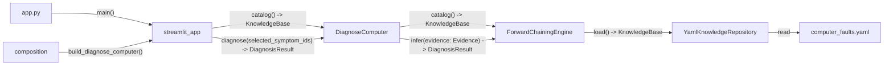

# Компонентен дијаграм

`composition.py` ги создава `YamlKnowledgeRepository`, `ForwardChainingEngine` и `DiagnoseComputer`. Екранот не го познава engine ниту репозиториумот. Ги повикува само `catalog` и `diagnose`.

