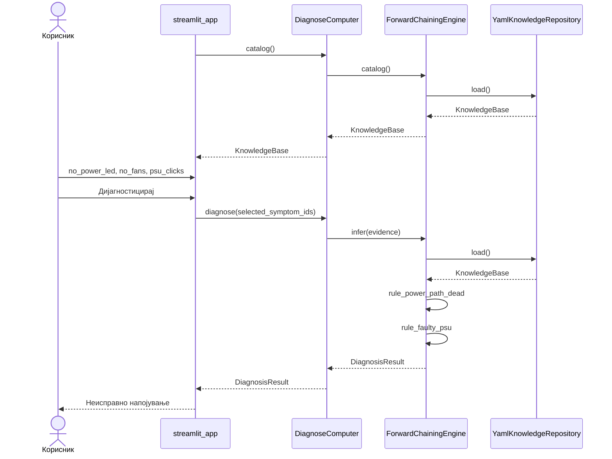
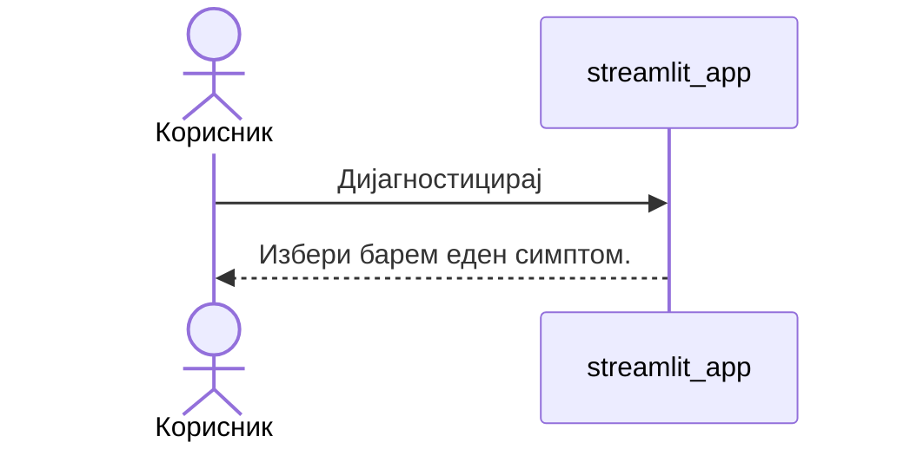

# Секвенциски дијаграми

## Успешна дијагноза со синџир

Корисникот избира `no_power_led`, `no_fans` и `psu_clicks`. Машината го активира `rule_power_path_dead`, го додава фактот `power_path_dead`, па го активира `rule_faulty_psu`. Резултатот е потврдена дијагноза „Неисправно напојување“.

## Празен избор

Корисникот притиска „Дијагностицирај“ без симптом. Предупредувањето останува на екранот. `DiagnoseComputer` не се повикува.

