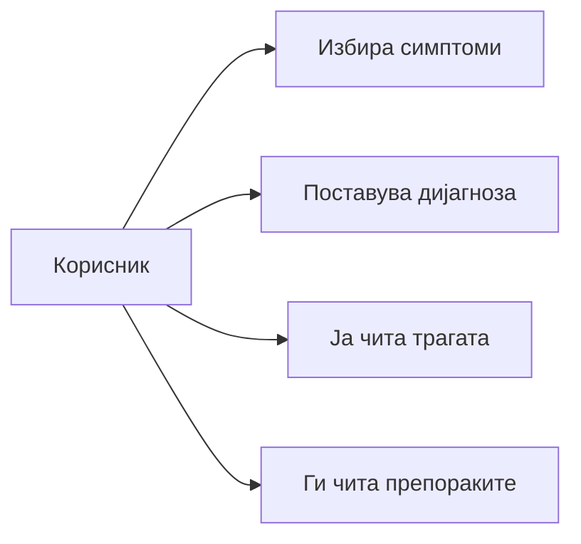

# Use case сценарио

Акторот е корисникот што го пушта системот за да дознае кој дефект ги објаснува симптомите на компјутерот.

## Главно сценарио

1. Корисникот ја отвора апликацијата.
2. Екранот го вчитува каталогот преку `DiagnoseComputer.catalog`.
3. Корисникот ги отвора потсистемите и ги штиклира симптомите што ги гледа.
4. Корисникот притиска „Дијагностицирај“.
5. Системот враќа рангирани дијагнози.
6. За секоја дијагноза корисникот чита назив, статус, процент, објаснување и препорачани проверки.
7. Во „Како се дојде до заклучокот“ ги гледа совпаднатите, недостасувачките и противречните услови.

## Продолжение: ниту еден симптом

1. Корисникот притиска „Дијагностицирај“ без избор.
2. Екранот покажува „Избери барем еден симптом.“
3. Повикот не стигнува до `DiagnoseComputer`.

## Продолжение: нема доволно совпаѓање

1. Корисникот избира симптоми што не достигнуваат праг 0,5.
2. Екранот покажува „Нема доволно совпаѓање со познатите дефекти.“ и ги наведува избраните називи.

