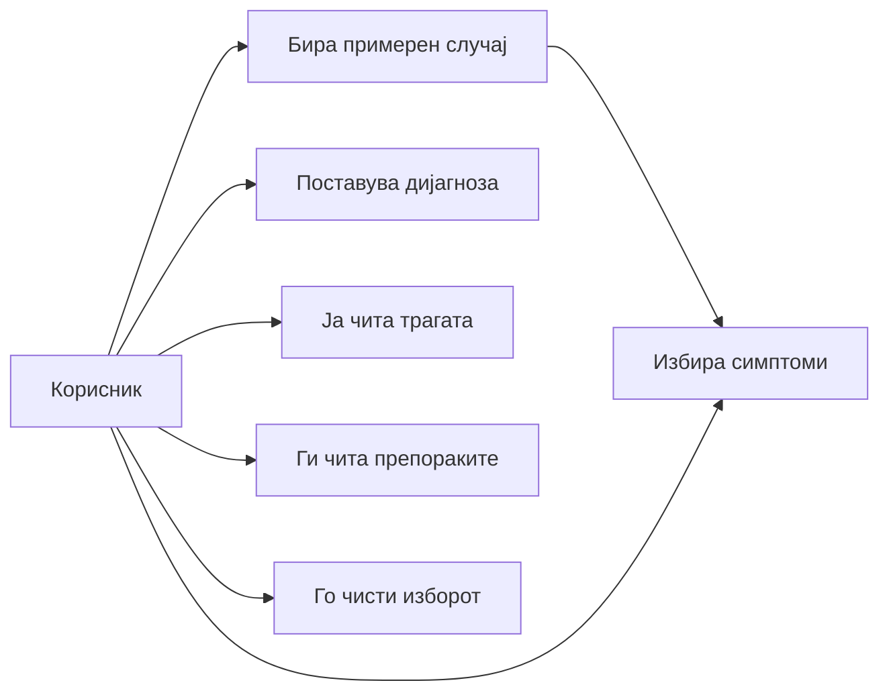
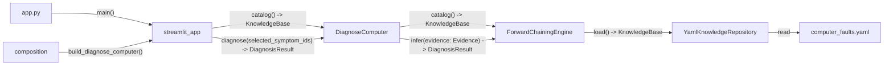
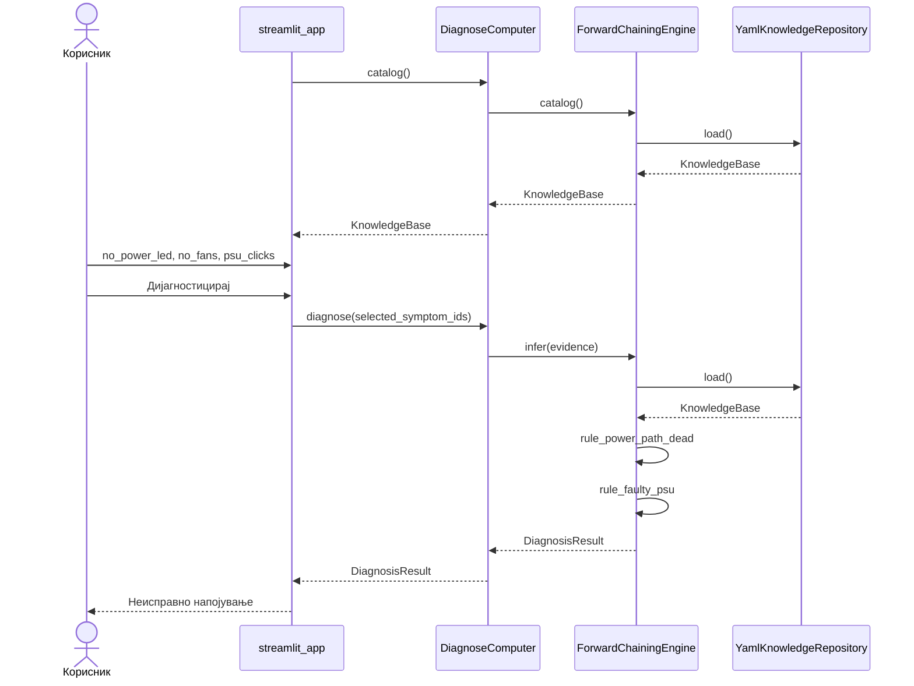
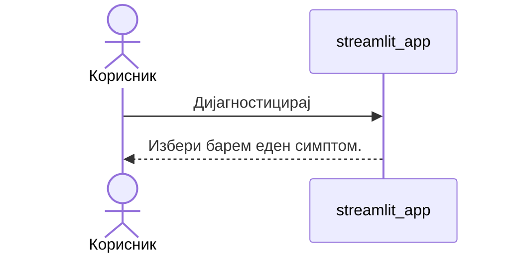

# Дијагностика на дефект кај компјутер според симптом

Никола Христовски, ИНКИ961  
Системи базирани на знаење

## 1. Вовед

### 1.1 Проблем

Корисникот гледа симптом: уредот не свети, дискот чука или Wi-Fi се кине. Од тој знак не се гледа веднаш кој дел е неисправен, ниту зошто еден дефект е поверојатен од друг. Проверката дел по дел одзема време и лесно се прескокнува знак што ги разделува две слични причини.

### 1.2 Цел

Целта е систем базиран на знаење што од избрани симптоми дава рангирана дијагноза, објаснување кои правила се активирале и конкретни проверки. Знаењето е одвоено од машината за заклучување, за ново правило да се додаде без промена на екранот.

### 1.3 Опсег

Системот покрива еден компјутер и чести дефекти по осум потсистеми: напојување, бутање, екран, диск, меморија, мрежа, перформанси и периферни уреди. Не мери хардвер, не учи од примери и не чува историја на корисници. Нема база на податоци: правилата се во една YAML датотека.

## 2. Главен дел

### 2.1 Опис на апликацијата

Апликацијата е експертски систем во Python. `app.py` ја пушта Streamlit страницата. `streamlit_app` ги повикува само `catalog` и `diagnose` на `DiagnoseComputer`. `composition.py` ги создава `YamlKnowledgeRepository`, `ForwardChainingEngine` и `DiagnoseComputer`. Репозиториумот ја чита `knowledge/computer_faults.yaml` при секое вчитување. Машината не ја отвора датотеката сама.

Корисникот штиклира симптоми по потсистем или притиска примерен случај, кој само ги избира симптомите и ја брише претходната дијагноза. Над копчињата стојат бројот и називите на избраните симптоми. Потоа притиска „Дијагностицирај“. „Исчисти“ ги трга штиклирањата и зачуваниот резултат. Резултатот е рангирана листа од картички со ред, статус, процент, објаснување, препораки и трага.

### 2.2 Use case сценарио и use case дијаграм

Акторот е корисникот.

Главно сценарио:

1. Корисникот ја отвора апликацијата и екранот го вчитува каталогот.
2. Ги отвора потсистемите и ги избира симптомите што ги гледа, или притиска примерен случај.
3. Го чита бројот и називите на избраните симптоми.
4. Притиска „Дијагностицирај“.
5. Чита рангирани картички со објаснување и препорачани проверки.
6. Во „Како се дојде до заклучокот“ ги гледа, за секое правило, објаснувањето, процентот и совпаднатите, недостасувачките и противречните називи.

Ако не е избран ниту еден симптом, екранот покажува „Избери барем еден симптом.“ и не го повикува use case. Ако ниту едно правило не го достигнува прагот 0,5, екранот јавува дека нема доволно совпаѓање и ги наведува избраните називи. „Исчисти“ го враќа екранот на празен избор.

### 2.3 Компонентен дијаграм и интеграциски интерфејси

Компонентите се `app.py`, `streamlit_app`, `composition`, `DiagnoseComputer`, `ForwardChainingEngine`, `YamlKnowledgeRepository` и `knowledge/computer_faults.yaml`.

Интерфејсите се:

- `catalog() -> KnowledgeBase` од екранот кон use case и од use case кон машината
- `diagnose(selected_symptom_ids) -> DiagnosisResult` од екранот кон use case
- `infer(evidence: Evidence) -> DiagnosisResult` од use case кон машината
- `load() -> KnowledgeBase` од машината кон репозиториумот

### 2.4 Секвенциски дијаграми

При симптоми `no_power_led`, `no_fans` и `psu_clicks`, машината прво го активира `rule_power_path_dead` и го додава фактот `power_path_dead`. Потоа `rule_faulty_psu` дава потврдена дијагноза „Неисправно напојување“.

Ако копчето се притисне без симптом, пораката останува на екранот и `DiagnoseComputer` не се повикува.

### 2.5 База на знаење и правила

Каталогот има 8 потсистеми, 34 симптоми, 16 дефекти, 2 факти и 25 правила. Правилото има `when_present`, `when_absent`, заклучок од вид `fact` или `fault`, објаснување и препораки. Правилата за факти немаат препораки. Тие носат меѓучекор што подоцна го користи правило за дефект.

Пример за синџир: `no_power_led` и `no_fans`, без `burning_smell`, го заклучуваат фактот `power_path_dead`. Ако во меморијата е и `psu_clicks`, `rule_faulty_psu` заклучува дефект `faulty_psu`. Вториот факт, `memory_subsystem_suspect`, на ист начин ги врзува звучните сигнали при бутање со правилата за меморија.

### 2.6 Inference engine

`ForwardChainingEngine` е forward chaining. Работната меморија почнува со избраните симптоми. За секое правило:

`score = исполнети услови / сите услови`

Услов од `when_present` е исполнет ако идентификаторот е во меморијата. Услов од `when_absent` е исполнет ако не е. Противречен симптом е избран симптом што правилото го бара како отсутен, па тој услов не влегува во броителот и резултатот е понизок.

Правило со резултат 1 е целосно активирано. Ако заклучува факт, фактот влегува во меморијата и прегледот на правилата почнува одново. Факт не се прикажува како дијагноза. Во трагата на дефект влегува само ако тој дефект го користи и правилото за фактот е целосно активирано.

Дефект се прикажува ако некое негово правило има резултат од најмалку 0,5 и барем еден баран елемент е во меморијата. Резултатот на дијагнозата е највисокиот резултат меѓу правилата за тој дефект. Резултат 1 е статус потврдена. Резултат од 0,5 до под 1 е можна. Листата е подредена по опаѓачки резултат, а при ист резултат по идентификатор на дефектот.

Пример: `thermal_shutdown`, `loud_fans_hot` и `no_fans`. Правилото `rule_overheating` бара два симптома и бара `no_fans` да отсуствува. Два од три услови се исполнети, резултатот е 2/3, и дијагнозата за прегревање е можна, не потврдена.

### 2.7 Резултати: влезови и излези

Влез се нула или повеќе симптоми од каталогот. Корисникот ги избира на екранот. Идентификатор што не е симптом ја подига `UnknownSymptomError`, а екранот јавува дека симптомот не постои во базата.

Пред првата дијагноза екранот пишува „Избери симптоми и притисни Дијагностицирај.“ Примерен случај не повикува `diagnose`. „Исчисти“ го брише изборот и резултатот.

Излезот е еден од трите:

- предупредување „Избери барем еден симптом.“ кога ништо не е избрано
- порака „Нема доволно совпаѓање со познатите дефекти.“ и листа на избраните називи
- рангирана листа од картички, а секоја носи ред, назив, резиме, статус „Потврдена“ или „Можна“, процент, објаснување и препораки. Трагата за секое правило носи објаснување, процент на тоа правило и називи што се совпаднати, што недостасуваат и што се противречни

Ако изборот се смени по дијагнозата, старите картички не остануваат. Екранот бара повторно притискање на копчето.

## 3. Заклучок

Системот од симптоми стигнува до рангиран дефект и покажува кое правило го донело заклучокот. Тоа е доволно за демонстрација на база на знаење, работна меморија и forward chaining. Границата е што каталогот ги покрива честите дефекти, не секој можен квар на секој уред.

## 4. Референци

1. Putri Sakinah, Yomei Hendra, Budy Satria, Zumardi Rahman, Fajar Maulana и Aldo Eko Syaputra. Implementation of a Forward Chaining Expert System in Diagnosing Laptop Damage. Internet of Things and Artificial Intelligence Journal, Vol. 4, No. 3, 2024. https://doi.org/10.31763/iota.v4i3.791. Пристапено: 15 октомври 2026.
   Причина: Го покажува истиот пристап, forward chaining од симптоми до дефект, на близок домен (лаптоп).

2. Muhammad Rehan Anwar. Analysis of Expert System Implementation in Computer Damage Diagnosis with Forward Chaining Method. International Transactions on Artificial Intelligence (ITALIC), Vol. 1, No. 2, May 2023, pp. 139–155. https://doi.org/10.33050/italic.v1i2.213. Пристапено: 15 октомври 2026.
   Причина: Ја врзува дијагнозата на компјутерски дефект со споредба на фактите со запишани правила.

3. Longfei Song, Yuqing Chen и Zhenjun Jin. Design of fault diagnosis expert system based on fault tree and production rules. Chinese Journal of Ship Research, објавено на 30 јануари 2024. https://www.ship-research.com/en/article/doi/10.19693/j.issn.1673-3185.03608. Пристапено: 15 октомври 2026.
   Причина: Објаснува како искуството се пренесува во продукциски правила и inference engine, што е обликот на базата во овој проект.

4. Python Software Foundation. dataclasses — Data Classes. Python 3 documentation. https://docs.python.org/3/library/dataclasses.html. Пристапено: 15 октомври 2026.
   Причина: Доменските типови се непроменливи dataclass-ови, и страницата е изворот за тој договор.

5. Streamlit. Streamlit documentation. https://docs.streamlit.io/. Пристапено: 15 октомври 2026.
   Причина: Екранот е Streamlit адаптер, а документацијата го опишува начинот на кој се пушта апликацијата.

6. PyYAML. PyYAML Documentation. https://pyyaml.org/wiki/PyYAMLDocumentation. Пристапено: 15 октомври 2026.
   Причина: Базата на знаење се чита од YAML, а документацијата го покрива `safe_load` што го користи репозиториумот.
